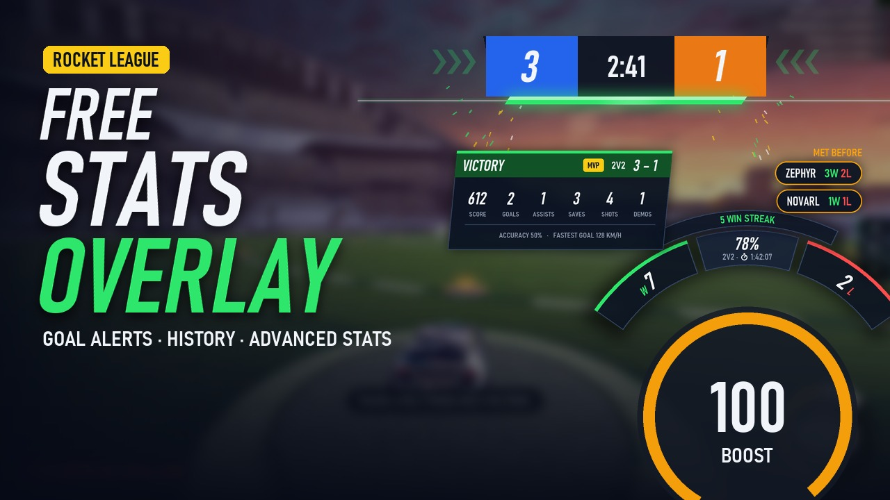
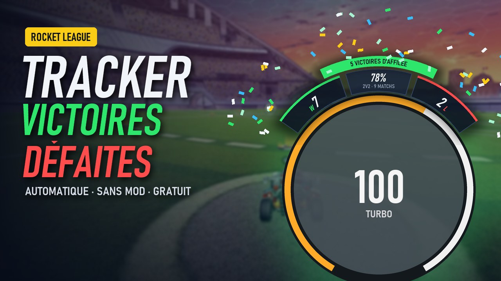

# RL Stats

**Automatic win / loss tracker for Rocket League**, displayed right around your boost meter.
Session stats per mode, post-match summary, history and progress charts, OBS browser source.


It uses Rocket League's **official Stats API** (the local socket Psyonix provides for overlays):
nothing is injected into the game and nothing touches the anti-cheat. Everything stays on your PC.

**▶ Demo video:**

[](https://youtu.be/Wo7JtuIgp4Q)

> 🇫🇷 [Version française plus bas](#-en-français)

---

## Download

👉 **[Download the latest version](https://github.com/benguedj/RL_Stats/releases/latest)** (`RL Stats.zip`, Windows 10/11)

1. Unzip and double-click **`RL Stats.exe`** (no install needed).
   Windows SmartScreen may say *"Windows protected your PC"*: click **More info → Run anyway**
   (the exe is not code-signed).
2. Start Rocket League, or **restart** it if it was already running (the game only reads its
   config at startup). The overlay enables the Stats API by itself.
3. In the game video settings, use **Borderless** display mode (an overlay can't be drawn over
   exclusive fullscreen).

Once the *"WAITING FOR GAME"* banner disappears, you're connected.

## Features

| | |
|---|---|
| **Automatic W/L counter** | Updates at the end of every online match. Leaving a match counts as a loss. |
| **Per-mode stats** | 1v1, 2v2, 3v3 and 4v4 are counted separately; the overlay shows the current mode (or all modes). |
| **Post-match summary** | Score, goals, assists, saves, shots, demos, accuracy, fastest goal, MVP badge. |
| **History & progress** | Every game is saved: daily win-rate chart, best streak, MVPs, averages, game list, CSV export. |
| **Opponents met before** | During the game, small chips next to the overlay show the opponents you already played, with your record. Teammates are left out (the game doesn't say who is in your party). |
| **Session goal & timer** | e.g. *10 wins tonight*, with progress shown on the overlay, and how long you've been playing. |
| **Animations & sounds** | Confetti on wins, shake on losses, an animation under the in-game score on every goal scored or conceded, optional sounds (off by default; built-in or your own MP3 / WAV). |
| **Customization** | 4 styles (scoreboard / minimal × curved / straight), size, colors, opacity. |
| **Multi-monitor & ultrawide** | Follows the game window on any screen, any resolution, windowed or borderless. |
| **Streamer mode** | A local page to add as an **OBS browser source**. Off by default. |
| **Tray icon & taskbar button** | Click to hide / show the overlay, right-click for the menu. |
| **Session card** | One click copies an image of your session to the clipboard, ready to paste in Discord. |
| **Advanced stats** | Kickoffs won, average boost, time at 0 boost, supersonic time, map of where your goals go in, for a period or a single game. |
| **Discord status** | Shows your mode, session score and streak on your Discord profile (Rich Presence, off by default). |
| **Tilt alert** | Suggests a break after 3 losses in a row or 2 hours of play (off by default). |
| **Smart display** | Hides itself when the game is closed or minimized, resumes your session if restarted within 2 h, can start with Windows and stay hidden until the game starts. |
| **Update notifications** | Tells you when a new version is available on GitHub. |
| **English / French** | Follows the Windows language, can be changed in Settings. |


| History | Settings |
|---|---|
|  |  |
| **Analysis** | |
|  | |

## Usage

- **Menu**: hover the overlay and click the `☰` button, or right-click it (or the tray icon), or press `Ctrl+Shift+O` in game: history, settings, appearance, players in the game, score correction, quit. Arrow keys, `Enter` and `Esc` work too.
- **Hover** the overlay: `+W` `-W` `+L` `-L` `☰` `X` buttons.
- **Drag** it to move it (the position is remembered per style).
- **Not lined up with your boost meter?** Set *Appearance → RL interface scale* to the same value as the game's *Interface Scale* setting, or pick the *Vertical (right edge)* shape, which doesn't depend on it.
- **Shortcuts**: `Ctrl+Shift+H` hide / show, `Ctrl+Shift+R` reset session, `Ctrl+Shift+O` open the menu (in game, the mouse cursor is hidden).
- **Players in this game (Tracker)**: click a name to open their Tracker Network profile (rank, MMR).
- If wins and losses are swapped: right-click → *Set my in-game name…*

### Streamer mode (OBS)

Settings → *Streamer mode*, then in OBS: **Sources → + → Browser**, URL `http://127.0.0.1:49124/`,
width 600, height 260. The server only listens on `127.0.0.1` (not reachable from the network).

## FAQ

**Can I get banned?** The overlay only reads the official Stats API, a feature Psyonix added for
overlays and tournament tools. It does not read game memory, inject code or modify game files
(it only sets `PacketSendRate` in your user config `TAStatsAPI.ini`).

**Why no rank / MMR?** The game doesn't send them through the Stats API. Use the Tracker links
in the players menu.

**Are offline / private matches counted?** Only online matches are counted.

**Where is my data?** In `%APPDATA%\RL Stats` (settings, match history, log). Your data is never
sent anywhere. The only network request is the update check, which asks GitHub for the latest
release version (can be turned off in Settings → System).

**Wasn't it called RL Overlay?** Yes, until version 1.1. Your settings and history are
migrated automatically from `%APPDATA%\RL Overlay` on first launch.

**Some advanced stats are missing.** Boost stats are only sent by the game for your own team, and
stats like kickoffs, boost and the goal map are recorded starting with version 1.1.

**My antivirus flags the exe.** Executables made with PyInstaller are sometimes flagged by mistake.
The full source is here: you can read it and [build the exe yourself](#build-from-source).

## Build from source

Requirements: Windows 10/11, Python 3.10+.

```bat
git clone https://github.com/benguedj/RL_Stats.git
cd RL_Stats
pip install -r requirements.txt
pythonw rl_stats.pyw
```

Build the standalone exe (`dist\RL Stats.exe` + `dist\RL Stats.zip`):

```bat
build.bat
```

### Project structure

| File | Role |
|---|---|
| `rl_stats.pyw` | Entry point: Stats API connection, match tracking, overlay window, tray icon, hotkeys |
| `designs.py` | Overlay styles, animations and match summary card, drawn with Pillow |
| `history.py` | Match history (`matches.json`) and statistics |
| `discord_rpc.py` | Discord status (Rich Presence) |
| `synth.py` | Built-in sounds (win, loss, goals), synthesized: no audio file shipped |
| `ui_windows.py` | Settings and History windows (Tkinter) |
| `popup_menu.py` | Overlay menu (dark panel, keyboard navigation) |
| `obs_server.py` | Local page for OBS (streamer mode) |
| `i18n.py` | English / French texts |
| `rl_stats.spec`, `build.bat` | PyInstaller build |
| `packaging/` | Readme files shipped in the zip |
| `tools/demo.py` | Scripted demo (fake games, captions) used to record the YouTube video |

## Code signing policy

Free code signing provided by [SignPath.io](https://about.signpath.io), certificate by
[SignPath Foundation](https://signpath.org).

Official releases are built from this repository by
[GitHub Actions](.github/workflows/release.yml), never on a personal machine. Only that build is
signed and attached to the [Releases](https://github.com/benguedj/RL_Stats/releases).

**Team roles**

- Committers and reviewers: [benguedj](https://github.com/benguedj)
- Approvers: [benguedj](https://github.com/benguedj)

Every signing request is approved by hand. All team members use two-factor authentication.

**Privacy**

This program will not transfer any information to other networked systems unless specifically
requested by the user or the person installing or operating it. In detail:

- **Update check**: at startup, it asks the GitHub API for the latest release number
  (`api.github.com`). No personal data is sent. It can be turned off in the settings.
- **Rocket League Stats API**: read from a local socket (`127.0.0.1:49123`) provided by the game.
- **Streamer mode (OBS)**: a page served on `127.0.0.1` only, not reachable from the network. Off by default.
- **Discord status**: sent to the Discord app running on your PC (local pipe), which shows it on
  your profile. Off by default.
- **Links** (GitHub page, player profiles on rocketleague.tracker.network) are opened in your
  browser only when you click them.

Match history and settings stay on your PC (`%APPDATA%\RL Stats`).

## License

[MIT](LICENSE) © benguedj

*RL Stats is a fan-made project, not affiliated with or endorsed by Psyonix or Epic Games.
Rocket League is a trademark of Psyonix LLC.*

---

## 🇫🇷 En français

**Compteur automatique de victoires / défaites pour Rocket League**, affiché autour de la jauge de boost.

**▶ Vidéo de démo :**

[](https://youtu.be/Wo7JtuIgp4Q)

👉 **[Télécharger la dernière version](https://github.com/benguedj/RL_Stats/releases/latest)**, puis :

1. Dézippe et lance **`RL Stats.exe`**. Si Windows affiche *« Windows a protégé votre ordinateur »* :
   **Informations complémentaires → Exécuter quand même** (l'exe n'est pas signé).
2. Lance Rocket League (ou **relance-le** s'il était ouvert). L'overlay active la Stats API tout seul.
3. Dans les options vidéo du jeu, choisis **Fenêtré sans bordure**.

**Fonctionnalités** : compteur par mode (1v1, 2v2, 3v3, 4v4), résumé après chaque match, historique
et graphique de progression, adversaires déjà croisés (affichés pendant le match), objectif et chrono de session,
animation sous le score à chaque but, animations et sons (intégrés ou tes propres MP3 / WAV),
personnalisation (designs, couleurs, opacité), multi-écrans et ultra-larges, mode streamer (OBS),
icône près de l'horloge, carte de session à coller sur Discord, statut Discord, stats avancées
(engagements, boost, carte des buts, par période ou par match), alerte tilt, masquage auto quand le jeu est fermé, reprise de session,
démarrage avec Windows, notification des mises à jour, français / anglais.

**Utilisation** : bouton `☰` au survol de l'overlay, clic droit (ou sur l'icône près de l'horloge) pour le menu,
glisser pour le déplacer, `Ctrl+Maj+H` pour le masquer, `Ctrl+Maj+R` pour réinitialiser la session,
`Ctrl+Maj+O` pour ouvrir le menu en jeu. Si l'overlay n'est pas aligné sur la jauge de boost, règle
*Apparence → Échelle de l'interface RL* sur la même valeur que l'échelle de l'interface du jeu, ou choisis la forme
*Verticale (bord droit)*.

Utilise la **Stats API officielle** de Rocket League : rien n'est injecté dans le jeu, aucun risque
avec l'anti-cheat. Les données restent sur ton PC (`%APPDATA%\RL Stats`).

**Signature et confidentialité** : les versions officielles sont construites par GitHub Actions
depuis ce dépôt, puis signées gratuitement par [SignPath.io](https://about.signpath.io) (certificat de
[SignPath Foundation](https://signpath.org)). Le seul accès à Internet est la vérification des mises à
jour (`api.github.com`, désactivable). Détails dans la [Code signing policy](#code-signing-policy).
